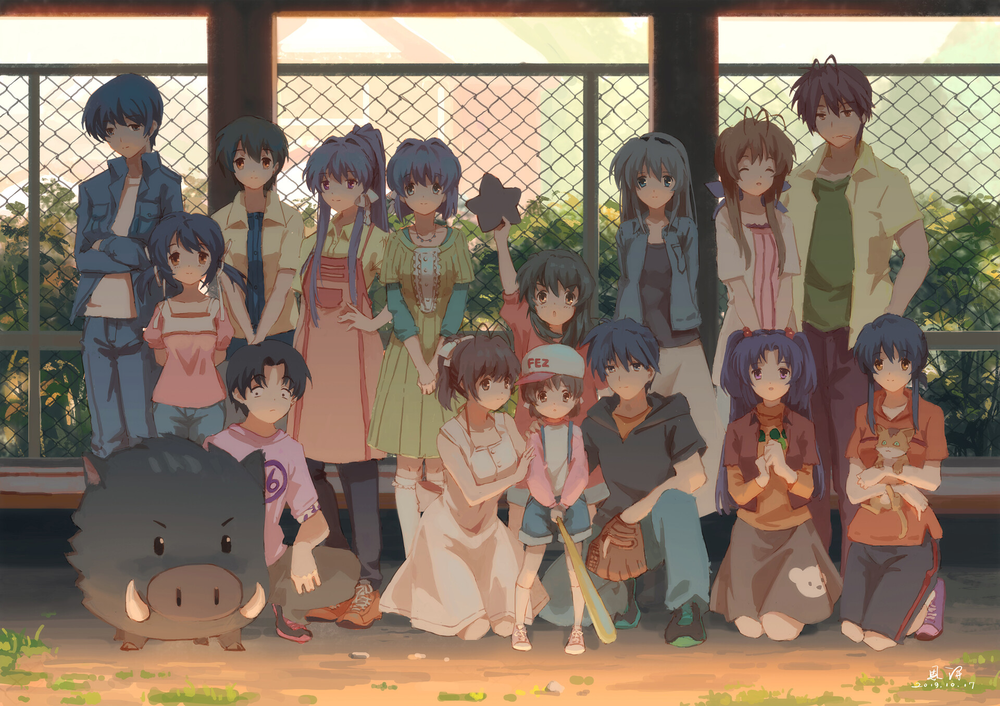

  

<h1 align="center">Hola, soy Matías Morales </h1>

  <em>"Si tu vida puede cambiar una vez, tu vida puede cambiar de nuevo."</em>

---

##  Sobre mí

- 💻 Estudiante técnico de desarrollo de software, apasionado por construir cosas con código.
- 🌱 Actualmente aprendiendo Python y TypeScript.
- 🎮 Me gusta el anime, los videojuegos y aprender cosas nuevas.

## Carrera

## Mi Tech Stack

  
  
  
  

## Intereses

- **Anime:** Clannad es mi favorito
- **Videojuegos:** me gusta mucho la saga dark soul 
- **Aprender:** siempre probando tecnologías y proyectos nuevos 

  
   
   Anime favorito: Clannad 

